# Client side: the one-minute report

What the **family** receives when something serious happens (a market drop, a tax law change).
The advisor approves a short text message; the link opens a one-page report that a client can read in a minute.

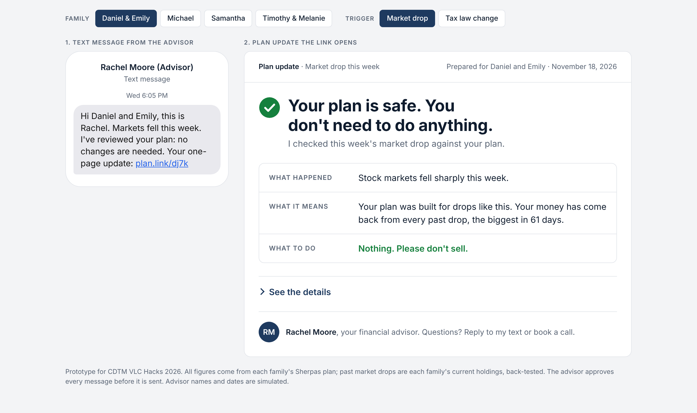

## The flow

1. An event hits the family's plan (market drop, 2027 tax values, a dated goal).
2. The advisor approves one text message (SMS: in the US, advisors text and email; WhatsApp/Telegram are rare and client messages must be archived for compliance).
3. The link opens the report:
   - one headline: *Your plan is safe. You don't need to do anything.*
   - three lines: **What happened**, **What it means**, **What to do**
   - a closed **See the details** section: the family's own past drops, the tax table, progress on each goal.

## Files

| Path | What it is |
|---|---|
| `prototypes/one-minute-report.html` | **Main prototype.** SMS + one-page report, per family, for a market drop or a tax change. Open it in any browser. |
| `prototypes/plan-advisor-tab.html` | Alternative: a "Your advisor" tab added to the family's existing plan page, with a chat. |
| `prototypes/family-chat.html` | Earlier version: chat with the advisor, one simple chart per message. |
| `prototypes/family-plan.html` | Earlier version: full dashboard per family (timeline of advisor checks, finances, goals). |
| `dashboard/` | Python app behind `family-plan.html`: SQLite database built from `cases/`, served locally. |

All HTML prototypes are self-contained: double-click to open, no install.

### Run the dashboard (optional)

```bash
cd client-report/dashboard
python3 build_db.py   # rebuilds data/sherpas.db from ../../cases
python3 app.py        # http://localhost:8000
```
Python standard library only. `python3 export_html.py out.html` exports it as one HTML file.

## Real vs simulated

- **Real** (from the case files): every figure, goals and dates, each family's back-tested drop in past market shocks, the 2027 tax values applied to each family.
- **Simulated**: advisor names, message dates and times, the short link, the fact that the advisor reviewed each event.
- **Our own calculation**: goal progress (retirement = share of retirement years the savings cover; college = money set aside / total cost; home = cash and investments / down payment; emergency savings = months covered / months recommended).

## Screenshots

### Market drop, one per family
| Daniel & Emily | Michael |
|---|---|
|  | 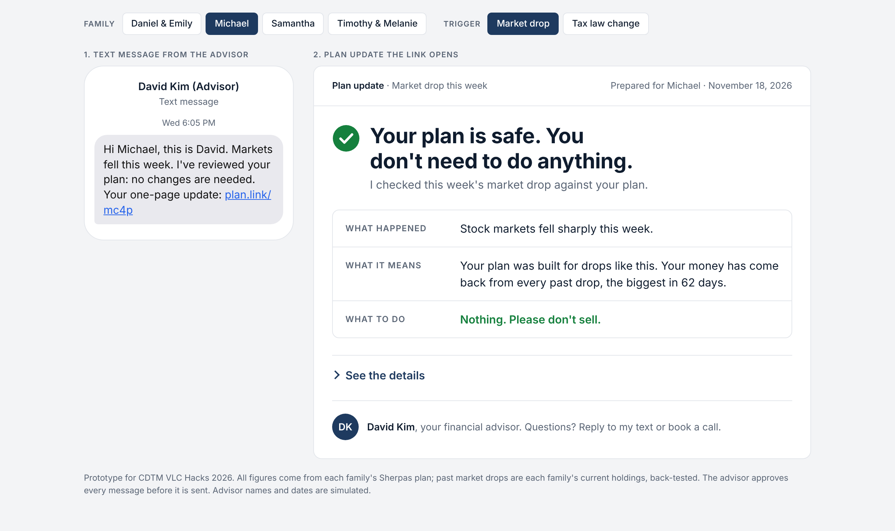 |
| **Samantha** | **Timothy & Melanie** |
| 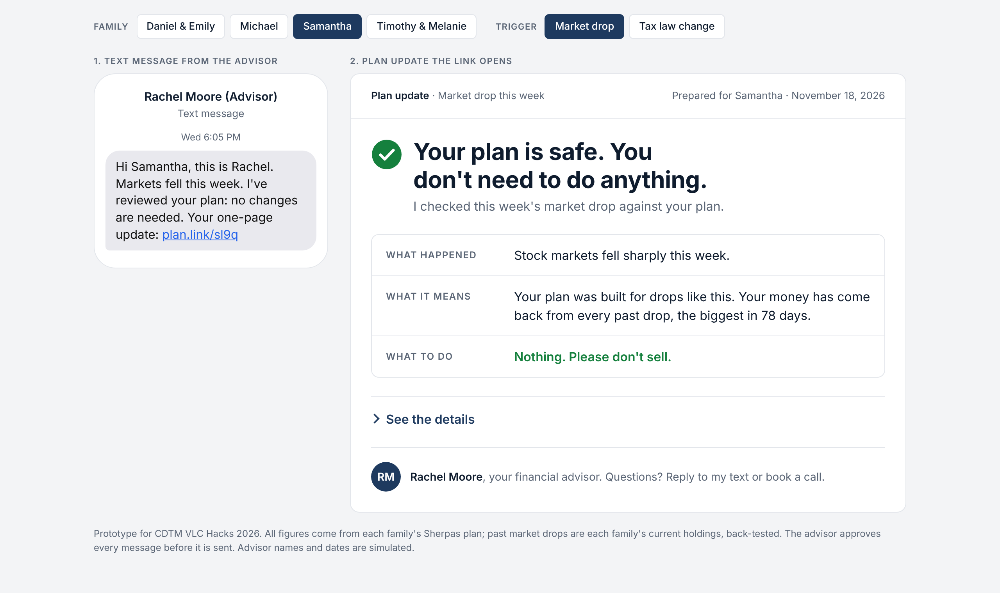 | 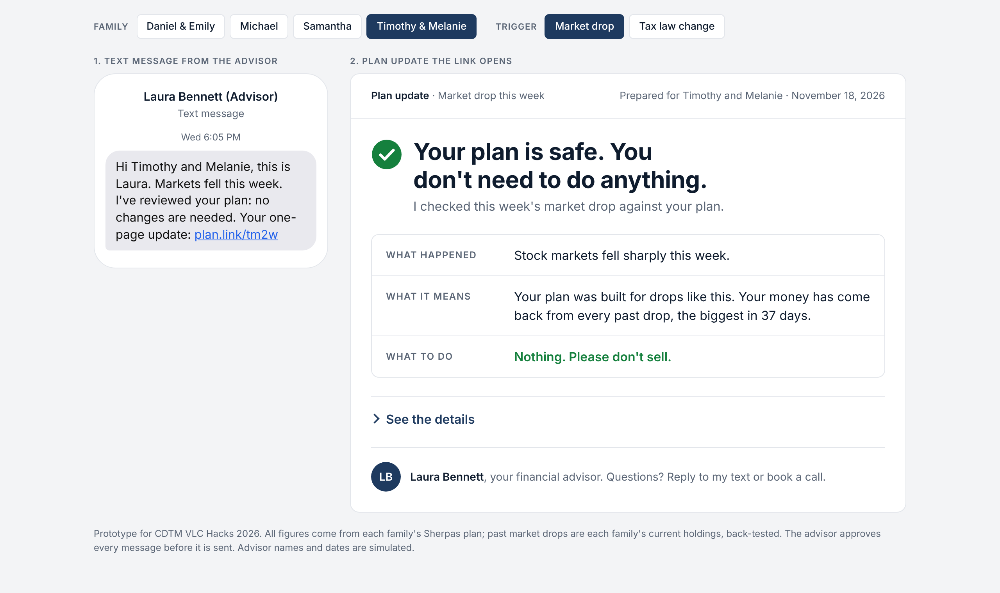 |

### 2027 tax change, one per family
| Daniel & Emily | Michael |
|---|---|
| 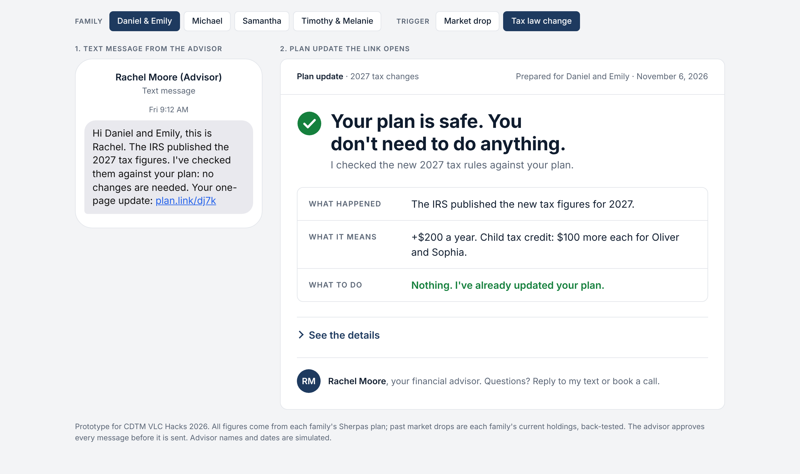 | 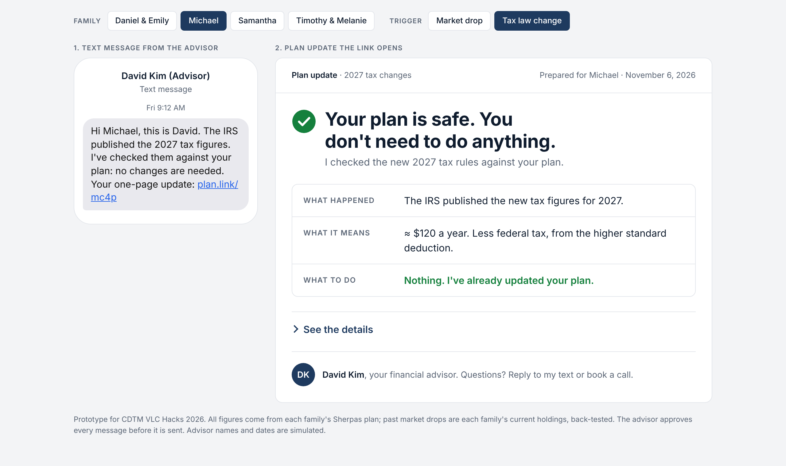 |
| **Samantha** | **Timothy & Melanie** |
| 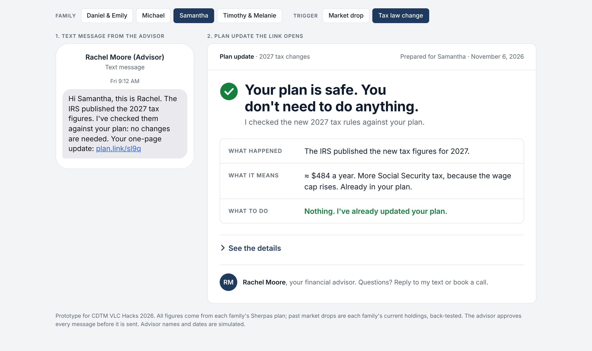 | 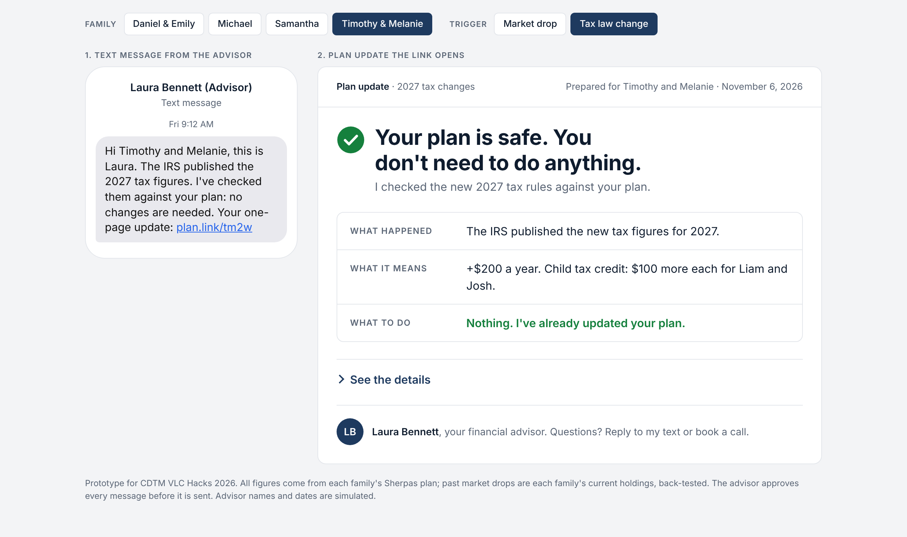 |

### Details opened, and on a phone
| See the details | Phone |
|---|---|
| 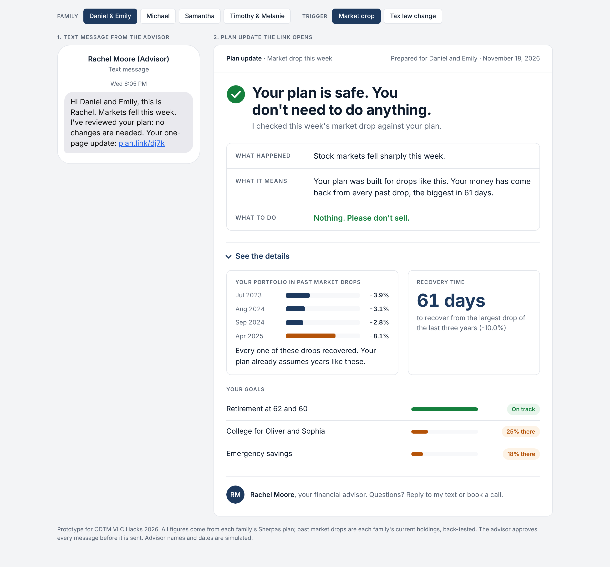 | 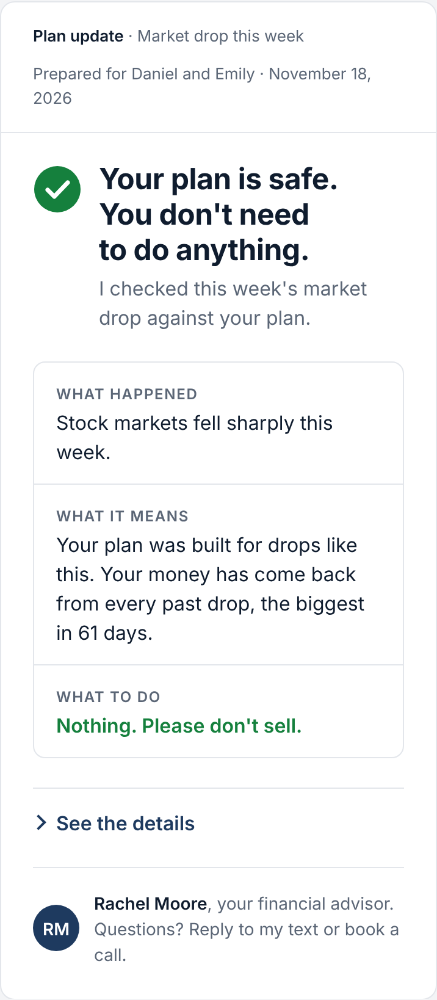 |

### Earlier prototypes
| Advisor tab in the plan | Chat | Family dashboard |
|---|---|---|
| 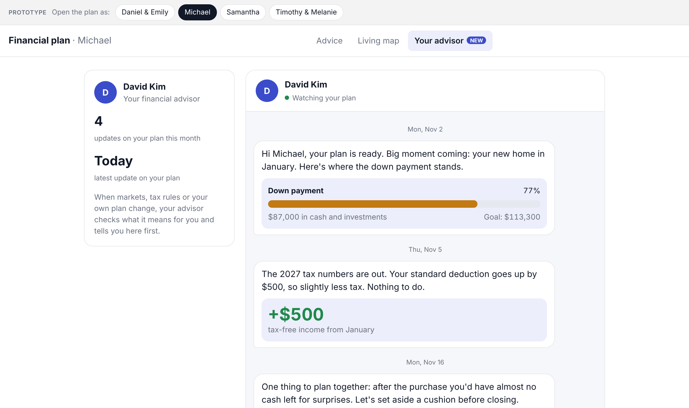 | 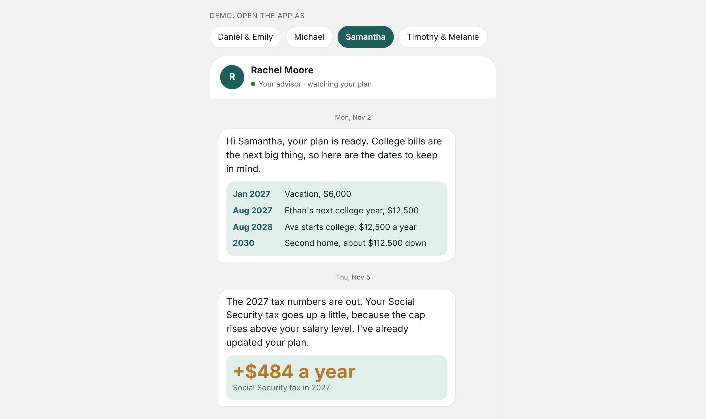 | 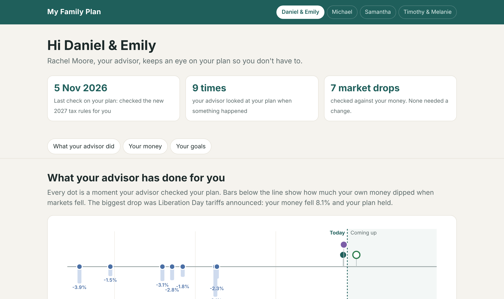 |
